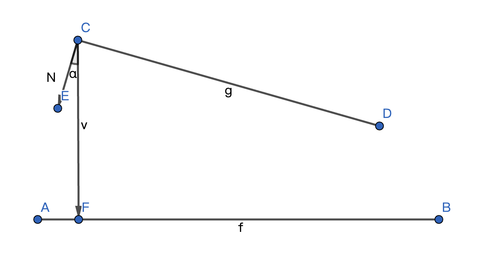
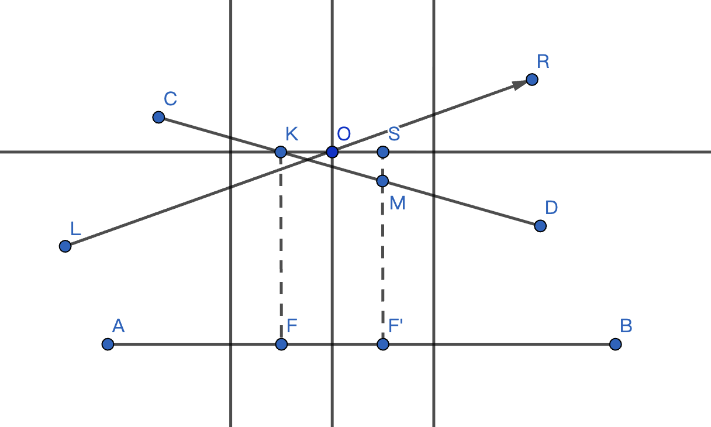
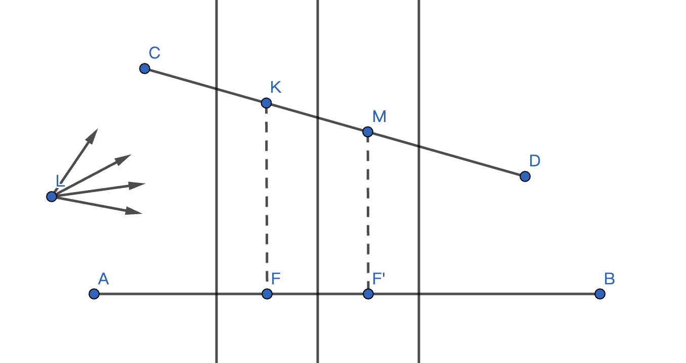
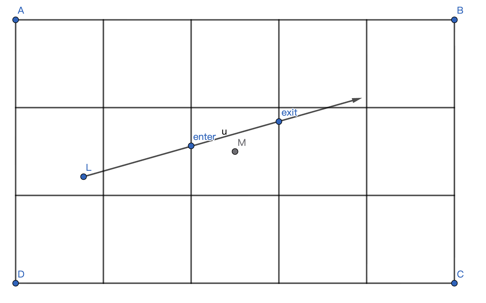
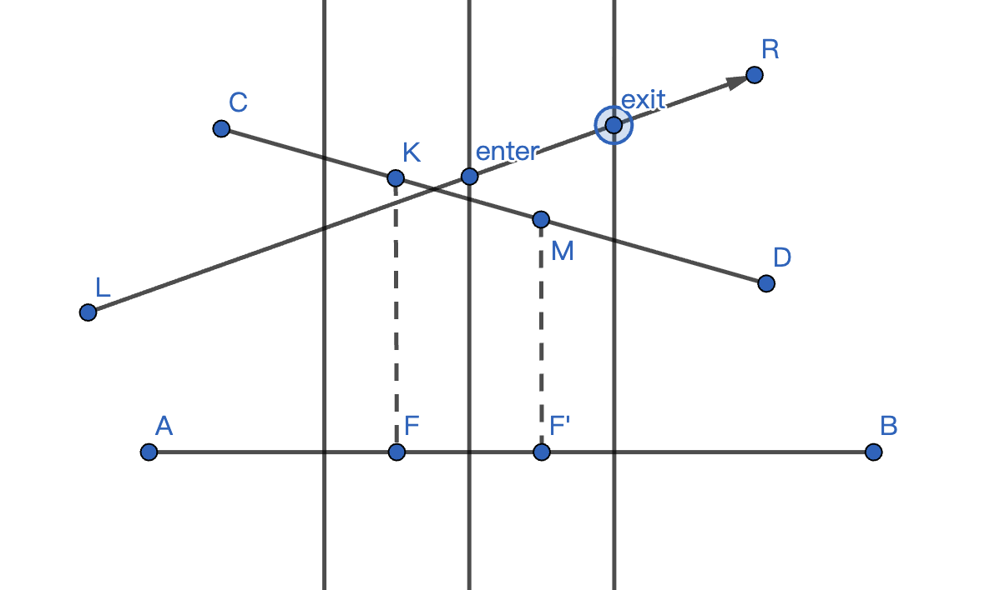

# Low-Resolution SSGI Ray-Intersection Optimization

This repository contains two Babylon.js experiments (`depthPara/plane` and `depthPara/lathe`) and the derivation behind a screen-space ray/depth intersection test intended to reduce missed intersections at low render resolutions.

The method combines:

1. A depth tolerance derived from the largest assumed surface slope across a pixel footprint.
2. A ray-depth interval computed over the pixel cell, rather than comparing the depth buffer to the ray at only one sample point.
3. A tolerant hit test that accepts a small depth gap, reducing false misses at discontinuities and coarse sampling.

The experiments demonstrate the method's logic; they are not a benchmark suite and do not establish a general performance or image-quality guarantee.

## Motivation

Screen-space global illumination (SSGI), ambient occlusion, and similar effects often trace rays against a depth buffer. Rendering that depth buffer at a reduced resolution lowers the cost, but each depth value represents a larger screen-space region. Neighboring pixels can therefore have substantially different depths, especially at silhouettes and steeply oriented surfaces.

A point-sample test compares the ray depth at one marching sample with a single stored pixel depth. A ray can pass through the geometric region represented by a pixel between samples, while neither sampled depth is close enough to pass a very small fixed epsilon. The result is a false miss (a *missed intersection*), which may appear as light leaks, dark edges, or flickering in downstream effects.

The optimization treats the depth-buffer sample as representing a pixel cell. It asks whether the ray's depth while traversing that cell overlaps the stored surface depth, and allows a geometrically bounded tolerance for the remaining gap.

## Geometric basis for the tolerance

Assume an orthographic view and a bound on the angle between the view direction and the visible surface normal. Under that assumption, the steepest relevant surface produces the greatest depth change across one pixel footprint.

Let the orthographic view cover half-width \(h_x\) and half-height \(h_y\), and let the depth image have dimensions \(W \times H\). The view-space dimensions of a pixel are

$$
\Delta x = \frac{2h_x}{W}, \qquad
\Delta y = \frac{2h_y}{H}.
$$

The longest distance across that rectangular pixel is its diagonal:

$$
K S_{\max} = \sqrt{(\Delta x)^2 + (\Delta y)^2}.
$$

For the limiting surface angle used by the implementation,

$$
\theta_{\max} = \arccos\left(\frac{1}{\sqrt{3}}\right)
  \approx 54.7356^\circ,
\qquad
\tan(\theta_{\max}) = \sqrt{2}.
$$

The maximum view-space depth difference across the pixel is bounded by the diagonal multiplied by the surface slope:

$$
\Delta z_{\max}
  = K S_{\max}\tan(\theta_{\max})
  = \sqrt{(\Delta x)^2 + (\Delta y)^2}\sqrt{2}.
$$

The experiments store depth normalized to the camera's near/far range, so the tolerance used in the code is

$$
\tau =
\frac{\sqrt{(\Delta x)^2 + (\Delta y)^2}
      \tan(\theta_{\max})}
     {z_{\mathrm{far}} - z_{\mathrm{near}}}.
$$

This is the expression used in both demos:

```ts
const threshold =
  Math.sqrt(deltaX * deltaX + deltaY * deltaY) *
  Math.tan(Math.acos(1 / Math.sqrt(3))) /
  (camera.maxZ - camera.minZ);
```

Reducing the depth-buffer resolution increases \(\Delta x\) and/or \(\Delta y\), which increases the tolerance. The derivation is conservative only under its assumptions: an orthographic projection and the stated bound on surface orientation. A larger tolerance can reduce missed hits, but may also classify a nearby, non-intersecting ray as a hit.

The patent description also discusses selecting, among multiple cameras, the view with the smallest angle to a surface normal. That camera-selection policy is a theoretical premise in the description; the included demos use a single orthographic camera and hard-code the limiting angle rather than implementing a multi-camera selection step.





## Ray depth over a pixel cell

The method operates in view space. For a ray with origin \(\mathbf{o}\), direction \(\mathbf{d}\), and ray parameter \(t\),

$$
\mathbf{p}(t) = \mathbf{o} + t\mathbf{d}.
$$

For an orthographic view, the pixel grid maps to axis-aligned rectangles in view-space \(x,y\). Given pixel \((i,j)\), its bounds are

$$
L=-h_x+i\Delta x,\quad R=L+\Delta x,
\qquad
T=h_y-j\Delta y,\quad B=T-\Delta y.
$$

The ray is intersected with the four sides of this rectangle. For a direction-independent slab calculation, compute the two parameter values for each axis:

$$
t_{x0}=\frac{L-o_x}{d_x},\quad t_{x1}=\frac{R-o_x}{d_x},
\qquad
t_{y0}=\frac{B-o_y}{d_y},\quad t_{y1}=\frac{T-o_y}{d_y}.
$$

Then

$$
t_{\mathrm{enter}}=
\max(\min(t_{x0},t_{x1}),\min(t_{y0},t_{y1})),
\qquad
t_{\mathrm{exit}}=
\min(\max(t_{x0},t_{x1}),\max(t_{y0},t_{y1})).
$$

If \(t_{\mathrm{enter}}>t_{\mathrm{exit}}\), the ray does not cross that pixel rectangle. Otherwise, evaluate the ray at both parameters. Convert the resulting view-space depths to the same normalized convention as the depth texture, and order them:

$$
d_{\min}=\min(d_{\mathrm{enter}},d_{\mathrm{exit}}),\qquad
d_{\max}=\max(d_{\mathrm{enter}},d_{\mathrm{exit}}).
$$

Thus, \([d_{\min},d_{\max}]\) is the interval of ray depths while the ray crosses the pixel cell. The depth texture contributes a representative surface depth \(d_p\) for that cell.







## Hit classification

For each stepped ray position, the implementation identifies a pixel, reads its depth \(d_p\), and computes the ray interval \([d_{\min},d_{\max}]\) through the pixel cell.

| Condition | Interpretation | Action |
| --- | --- | --- |
| \(d_{\min} \le d_p \le d_{\max}\) | The stored surface depth lies inside the ray's depth interval in this cell. | Accept as a hit. |
| \(d_p < d_{\min}\) and \(d_{\min}-d_p < \tau\) | The surface is just outside the interval, but the gap is within the pixel-footprint bound. | Accept as a tolerant hit. |
| \(d_{\max} < d_p\) | The ray interval is in front of the stored surface depth under the implementation's depth ordering. | Continue marching. |
| No accepted hit before the step limit | The ray did not satisfy either hit condition during the tested traversal. | Return the demo's terminal status. |

## Included experiments

### `depthPara/plane`

A plane-based experiment compares the ray-depth interval against a low-resolution depth texture. The active configuration creates a \(1024 \times 512\) depth target; a \(256 \times 128\) configuration is also present in the source as a commented experiment. The old point-sample comparison remains commented out, while the interval-based test is active.

### `depthPara/lathe`

A lathe-scene experiment uses an orthographic camera with `len = 1.2`, a \(200 \times 100\) depth target, and a 50-step ray traversal. The code includes both the earlier point-sample test (commented out) and the newer interval/tolerance test (active). The screenshots below are captured console output from the two runs.

## Observed test result

The supplied lathe screenshots show one test ray for which the earlier point-sample method did not report a hit within its 50-step traversal, while the interval-based method reported a hit on its third sample (zero-based iteration `i = 2`).

| Run | Observed output | Evidence |
| --- | --- | --- |
| Earlier point-sample test | `flag = 3` after the 50-step loop; the screenshot's final sample is iteration 49 at pixel `(189, 58)`. |  |
| Interval and tolerance test | `flag = 1` at iteration 2, pixel `(189, 41)`. The stored pixel depth is `0.0004327812639530748`; the ray interval is `[0.00043277502096399697, 0.00043509104646426844]`, so the pixel depth lies inside the interval. |  |
| Earlier trace samples | Shows sample depth values from the earlier traversal. |  |

This is evidence that the revised test changes the outcome for the recorded ray in this scene. The supplied materials do not include ground-truth intersection labels, repeated-scene hit-rate measurements, frame-time measurements, or a controlled image-quality comparison. Therefore, no numeric accuracy improvement or performance speedup is claimed here.

## Running the demos

Each demo is an independent Babylon.js project:

```bash
cd depthPara/plane
npm install
npm run dev
```

Or run the lathe experiment:

```bash
cd depthPara/lathe
npm install
npm run dev
```

Both projects also provide `npm start` and `npm run build` scripts. The lathe source currently loads `lathe.babylon` from a URL configured in `depthPara/lathe/src/main.ts`; depending on that URL's availability, the scene asset may need to be served locally when running the copied project.

## Implementation notes and limitations

- The derivation assumes an orthographic projection. Perspective projection requires accounting for the changing pixel footprint with depth.
- The chosen \(\theta_{\max}\) is embedded as a constant; the demos do not calculate it from scene geometry or select a camera per surface point.
- The source code is experimental. Its pixel indexing and ray/rectangle boundary calculations are written for the tested camera/ray orientations; a reusable implementation should use signed slab intervals, handle near-zero direction components, reject out-of-range pixel coordinates, and consistently account for depth-buffer orientation and background pixels.
- The interval and tolerance tests deliberately prefer avoiding false misses. They can introduce false-positive hits when the ray is close to, but does not actually intersect, a surface.
- The screenshots demonstrate one recorded ray outcome, not a proof of correctness for arbitrary geometry, camera settings, or ray directions.
